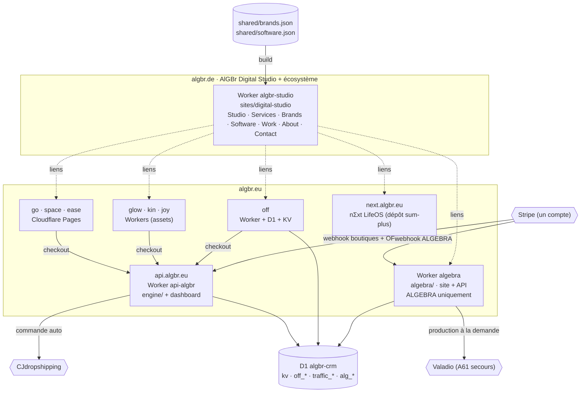

# Architecture cible de l'écosystème AlGBr

Document de référence (27 octobre 2026). Complète `ALGBR_AUDIT.md`. Tout changement de production décrit ici
(DNS, domaines personnalisés, webhooks, passage en live) reste soumis à **validation explicite du propriétaire**.

## 1. Principe

Deux domaines porteurs, des boutiques en sous-domaines, une infrastructure commune, trois circuits de commande séparés.



Version texte :

```
algbr.de ──────────── Worker algbr-studio (statique + /api/contact) ← shared/brands.json, software.json
algbr.eu ──────────── Worker algebra (statique + /api/*)  ──► D1 alg_* ──► Valadio
  go/space/ease ───── Cloudflare Pages ─┐
  glow/kin/joy ────── Workers assets ───┼──► api.algbr.eu (Worker api-algbr) ──► D1 kv ──► CJ
  off ─────────────── Worker + D1 + KV ─┘                                       └─► OFF. : stock propre (Hermes)
  next ────────────── nΣxt LifeOS (hors dépôt)
www.* ─────────────── Redirect Rules Cloudflare → domaine canonique (301)
algebra.algbr.eu ──── Redirect Rule → https://algbr.eu (301, après bascule)
*.algbr.de boutiques ─ redirections existantes inchangées
```

## 2. Domaines

| Domaine | Fonction | Hébergement cible | État dans cette branche |
|---|---|---|---|
| algbr.eu | ALGEBRA | Worker `algebra`, environnement `apex` | Préparé, non activé |
| www.algbr.eu | → algbr.eu | Redirect Rule de zone | À créer à la bascule |
| algebra.algbr.eu | → algbr.eu | Redirect Rule de zone (le domaine reste attaché au Worker pour le retour arrière) | À créer à la bascule |
| algbr.de | Digital Studio + écosystème | Worker `algbr-studio`, environnement `live` | Préparé, non activé |
| www.algbr.de | → algbr.de | Redirect Rule | À créer |
| go / space / ease / glow / kin / joy / off.algbr.eu | Boutiques | inchangé | inchangé |
| go.algbr.de, space.algbr.de, ease.algbr.de, off.algbr.de… | → .eu | Porkbun (actuel) | inchangé, à reproduire si la zone algbr.de passe chez Cloudflare |
| api.algbr.eu | API e-commerce + dashboard | Worker `api-algbr` | inchangé |
| next.algbr.eu | nΣxt LifeOS | dépôt `sum-plus` | inchangé ; un domaine propre au produit pourra être étudié plus tard, mais ce sous-domaine est déjà référencé et lié : ne pas le déplacer sans plan de redirection |

Règle pour les futurs logiciels : un sous-domaine `<produit>.algbr.eu` ou un domaine dédié, déployé hors de
l'infrastructure e-commerce (pas de route sur `api-algbr`, pas de table dans `algbr-crm`), déclaré dans
`shared/software.json`.

## 3. Dépôt

La cible conceptuelle du brief est atteinte **sans déplacer** les dossiers existants (les chemins sont des
dépendances de builds, d'imports statiques, de projets Pages et de Workers) :

```
Nomad/
├── sites/digital-studio/   NOUVEAU · build.mjs, content/, assets/, worker/, wrangler.toml, tests via npm test
├── algebra/                inchangé (paquet autonome) + environnement apex + redirections héritées du Studio
├── shops/<go|space|ease|glow|kin|joy|off>/   inchangé
├── engine/  backend/  public/  scripts/      inchangé (sauf garde webhook et liens d'organisation)
├── shared/
│   ├── brands.json         NOUVEAU · registre des marques
│   ├── software.json       NOUVEAU · registre des logiciels
│   ├── registry.mjs        NOUVEAU · chargement + validation (sans dépendance)
│   └── platform.json       configuration de vente (API, encart nΣxt, famille) · inchangé sur le fond
├── tests/registry.test.mjs NOUVEAU · registre ↔ site.json ↔ config ALGEBRA ↔ OFF. ↔ platform.json
└── docs/architecture/      ce document et l'audit
```

## 4. Registres

`shared/brands.json` : **identité et politique**, jamais de prix, de stock ni de catalogue.

| Champ | Rôle | Source de vérité vérifiée par test |
|---|---|---|
| `id` | identifiant stable du registre (`go`, `algebra`…) | unique |
| `storeId` | id historique des commandes (`nomad`, `appart-reset`, `body-care`…) | = `site.json` → `id` |
| `name` | nom public | = `site.json` → `brand` |
| `domain`, `url` | domaine officiel et adresse liée aujourd'hui | = `site.json` → `baseUrl`, `wrangler.toml` d'OFF., `SITE_ORIGIN` d'ALGEBRA |
| `migration` | domaine cible et état d'une migration en cours | ALGEBRA : `algbr.eu`, `planned` |
| `positioning`, `category`, `description` | textes DE/EN/FR du portfolio | registre |
| `status` | `live`, `preview`, `seasonal`, `planned` | `launched` de `site.json`, `SITE_MODE` |
| `logo`, `theme` | fichier existant et couleurs | fichier présent ; `theme.primary` = `themeColor` |
| `languages` | langues du site | = `site.json` → `languages`, config ALGEBRA, i18n OFF. |
| `shopType` | `dropshipping` (moteur commun), `own-stock` (OFF.), `print-on-demand` (ALGEBRA) | registre |
| `portfolioPriority` | ordre d'affichage | unique |
| `crossPromotion.eligible` | peut apparaître dans l'encart « famille » des autres boutiques | ALGEBRA : `false` ; aucune sélection de `platform.json` ne peut viser une marque non éligible |
| `crossPromotion.showsFamily` | affiche lui-même l'encart | ALGEBRA : `false` |

L'accroche (`tagline`) n'est pas dupliquée : `shared/registry.mjs` la lit dans `site.json` au build du Studio.

`shared/software.json` : `id`, `name`, `aliases`, `url`, `repository`, `status`, `version`, `platforms`,
`languages`, `summary`, `features`, `access`, `public`, `portfolioPriority`. Un logiciel `public: false` n'est jamais
publié sur le Studio.

## 5. Déploiements

| Projet | Déclencheur (chemins) | Commande | Remarque |
|---|---|---|---|
| api-algbr | `engine/**`, `backend/**`, `public/admin/**`, `shared/platform.json`, `shared/prospects.json`, `shared/alt-keywords.json`, `shops/*/products.json`, `shops/*/site.json`, `scripts/build.mjs`, `package*.json` | `npm run deploy:api` | filtre resserré (avant : `shared/**`) |
| glow / kin / joy | inchangé | `npm run deploy:<x>` | |
| off-algbr | inchangé | `npm run deploy:off` | |
| algebra | `algebra/**` | `npm test`, `npm run build`, `wrangler deploy` (ou `--env apex` après bascule) | interrupteur `vars.ALGEBRA_ORIGIN` |
| **algbr-studio** | `sites/digital-studio/**`, `shared/brands.json`, `shared/software.json`, `shared/registry.mjs`, `shops/*/site.json`, `shops/*/assets/favicon.svg`, `algebra/brand/**` | `node --test` (Studio + registre), build, `wrangler deploy` (ou `--env live`) | nouveau job ; interrupteur `vars.STUDIO_LIVE` |
| GO / SPACE / EASE | Cloudflare Pages (Git) | réglé dans Cloudflare | **Régler les « Build watch paths »** de chaque projet Pages : `shops/<x>/**`, `public/**`, `scripts/**`, `shared/platform.json`, `package*.json` ; sinon chaque push sur le Studio reconstruit ces trois boutiques |

Les interrupteurs sont des **variables de dépôt GitHub** (Settings → Secrets and variables → Actions → Variables) :

| Variable | Absente (défaut) | Valeur de bascule |
|---|---|---|
| `ALGEBRA_ORIGIN` | build pour `https://algebra.algbr.eu`, déploiement environnement par défaut (route actuelle) | `https://algbr.eu` → build pour algbr.eu, `wrangler deploy --env apex` (route `algbr.eu` + redirections héritées du Studio) |
| `STUDIO_LIVE` | Worker `algbr-studio` publié sur `*.workers.dev` uniquement (prévisualisation) | `true` → `wrangler deploy --env live` (domaine personnalisé `algbr.de`) |

Ainsi, fusionner cette branche **ne bascule aucun domaine** ; la bascule est une action volontaire, réversible en
supprimant la variable et en relançant le workflow.

## 6. Plan de migration DNS

### État DNS constaté (27 octobre 2026, résolveur public dns.google)

| Nom | Serveurs DNS | Enregistrements | Conséquence |
|---|---|---|---|
| algbr.eu | **Cloudflare** | apex `A` ×4 → 185.199.108–111.153 (**GitHub Pages**), `www` CNAME → guy2b.github.io | Le Studio actuel est servi par GitHub Pages (dépôt `algbr`), pas par Firebase. Ce sont ces 5 enregistrements qu'il faudra retirer à l'étape 2. |
| algbr.eu (messagerie) | Cloudflare | MX fwd1/fwd2.porkbun.com, SPF Porkbun, DMARC `p=none`, DKIM `resend._domainkey`, MX `send` (Resend), vérification Google | **Ne pas toucher.** Ils prouvent aussi que le transfert e-mail Porkbun fonctionne avec un DNS hébergé ailleurs. |
| next.algbr.eu | Cloudflare | CNAME → guy2b.github.io (GitHub Pages) | Indépendant de la bascule. |
| algebra, go, off, api.algbr.eu | Cloudflare | proxifiés (188.114.96–97.3) | Inchangés. |
| algbr.de | **Porkbun** | apex et `www` : redirection Porkbun (vers algbr.eu) ; MX fwd1/fwd2.porkbun.com (contact@algbr.de) ; SPF Porkbun ; vérification Google | Pas de domaine personnalisé Worker possible tant que la zone est chez Porkbun. |
| go, space, ease, glow, kin, off.algbr.de | Porkbun | redirections Porkbun (uixie) | À recréer si la zone passe chez Cloudflare. glow et kin ont donc bien leur `.de`. |
| joy.algbr.de | Porkbun | réponse générique Porkbun (pixie) | Pas de redirection configurée. |

### Étape 0 · Inventaire (avant tout)
1. Cloudflare → zone `algbr.eu` → DNS → « Export » : garder le fichier. Il contient les 5 enregistrements GitHub Pages
   et toute la messagerie (tableau ci-dessus).
2. Porkbun → algbr.de → « DNS Records » et « URL Forwarding » et « Email Forwarding » : capture ou export de chaque
   écran (règles de transfert de contact@algbr.de comprises).
3. Stripe : lister les endpoints webhook (Developers → Webhooks) et leurs événements.

### Étape 1 · Studio sur algbr.de (sans toucher à algbr.eu)
1. Fusionner la branche ; le job `studio` publie `algbr-studio` sur `algbr-studio.<compte>.workers.dev`.
2. Recette sur cette URL (liste §8). Ajouter `RESEND_API_KEY` (et facultativement `TURNSTILE_SECRET` + variable
   `STUDIO_TURNSTILE_SITEKEY`) au Worker `algbr-studio`.
3. Cloudflare → « Add a domain » → `algbr.de` (offre gratuite). Avant de changer les serveurs de noms, vérifier la zone
   importée et la compléter :
   - **MX** `fwd1.porkbun.com` (10) et `fwd2.porkbun.com` (20), **TXT** SPF `v=spf1 include:_spf.porkbun.com ~all`,
     TXT de vérification Google : copiés à l'identique (le transfert e-mail reste géré chez Porkbun, comme pour algbr.eu) ;
   - supprimer les enregistrements importés qui pointent vers les redirections Porkbun (207.207.210.x, uixie, pixie) ;
   - Redirect Rules (301) : `go.algbr.de/*` → `https://go.algbr.eu/${1}`, idem `space`, `ease`, `glow`, `kin`, `off`
     (et `joy` si souhaité), chacun avec un enregistrement DNS proxifié (par exemple `AAAA 100::`) pour que la règle
     s'applique ;
   - `www.algbr.de` : enregistrement proxifié + Redirect Rule vers `https://algbr.de/${1}`.
4. Porkbun → algbr.de → « Authoritative Nameservers » : remplacer par les deux serveurs Cloudflare indiqués.
   Attendre l'état « Active » dans Cloudflare, puis vérifier : redirections des sous-domaines, et un e-mail de test
   reçu sur contact@algbr.de.
5. Variable de dépôt `STUDIO_LIVE=true`, relancer le workflow : le domaine personnalisé `algbr.de` est attaché au
   Worker. À partir de là, algbr.de affiche le nouveau Studio au lieu de rediriger vers algbr.eu.

### Étape 2 · ALGEBRA sur algbr.eu
1. Prérequis : Studio en ligne sur algbr.de (sinon les anciennes URL redirigées n'auraient pas de destination).
2. Stripe : créer l'endpoint `https://algbr.eu/api/stripe/webhook` (mêmes événements que l'actuel), copier son secret.
3. Dans la zone algbr.eu, supprimer **uniquement** les 4 `A` de l'apex (185.199.108–111.153) et le CNAME `www`
   (guy2b.github.io) ; garder MX, TXT, DKIM, `send`. Dans le dépôt `algbr` → Settings → Pages, retirer le domaine
   personnalisé `algbr.eu` (ne pas toucher au dépôt de nΣxt, qui sert `next.algbr.eu`).
4. Variable `ALGEBRA_ORIGIN=https://algbr.eu`, relancer le workflow : build avec le nouvel origin, déploiement
   `--env apex` (route `algbr.eu`, `SITE_ORIGIN`, CORS, redirections des anciennes URL du Studio).
5. Mettre le nouveau `STRIPE_WEBHOOK_SECRET` sur le Worker `algebra` (le Worker est le même : ses secrets sont conservés).
6. Redirect Rules : `www.algbr.eu/*` → `https://algbr.eu/${1}` ; `algebra.algbr.eu/*` → `https://algbr.eu/${1}` (301).
7. Contrôles (§8), puis Search Console : ajouter `algbr.de`, soumettre les deux sitemaps, outil de changement
   d'adresse **non** utilisé (il ne s'agit pas d'un déménagement complet de site).
8. Garder l'ancien endpoint webhook `algebra.algbr.eu` actif 30 jours (sessions Stripe ouvertes avant la bascule),
   puis le désactiver.

### Étape 3 · Nettoyage (après 30 jours sans incident)
- Retirer `algebra.algbr.eu` des routes du Worker (la Redirect Rule suffit).
- Archiver ou rediriger le dépôt `algbr` ; supprimer le site Firebase et la publication GitHub Pages.
- Corriger le lien « by AlGBr » de nΣxt (dépôt `sum-plus`) vers `https://algbr.de/`.

## 7. Procédure de retour arrière

| Situation | Action | Délai |
|---|---|---|
| Studio défaillant sur algbr.de | Supprimer `STUDIO_LIVE`, relancer le workflow ; dans Cloudflare, détacher le domaine personnalisé `algbr.de` du Worker et ajouter une Redirect Rule `algbr.de/*` → `https://algbr.eu/${1}` (comportement d'avant) | minutes |
| ALGEBRA défaillant sur algbr.eu | Supprimer `ALGEBRA_ORIGIN`, relancer le workflow : rebuild pour `algebra.algbr.eu`, route d'origine ; supprimer la Redirect Rule `algebra.algbr.eu` ; recréer les enregistrements apex depuis l'export pour remettre l'ancien Studio sur algbr.eu | 15 à 30 min (+ propagation DNS) |
| Webhook ALGEBRA en échec | L'ancien endpoint reste actif ; Stripe rejoue les événements pendant 3 jours | immédiat |
| Erreur de code | `git revert` du commit fautif sur `main` ; Cloudflare → Worker → Deployments → version précédente | minutes |
| Zone algbr.de | Remettre les serveurs de noms Porkbun d'origine (l'ancienne zone Porkbun n'est pas supprimée avant 30 jours) | jusqu'à 24 h |

Aucune étape ne modifie la D1, les commandes, les stocks ou les prix : le retour arrière ne concerne que le routage.

## 8. Recette avant chaque bascule

- `npm test` (racine) et `cd algebra && npm test` verts ; builds sans erreur.
- Studio : chaque page DE/EN/FR répond 200, liens internes et sortants valides (script de vérification des liens
  du build), formulaire : envoi réel vers `OWNER_EMAIL` en prévisualisation, refus du pot de miel, message clair si
  l'envoi échoue, en-têtes de sécurité présents.
- ALGEBRA sur le nouvel origin : canonical, hreflang et sitemap en `https://algbr.eu/…`, panier, checkout **Stripe
  test** (carte 4242…), retour sur `/order/success/`, webhook reçu (Stripe → Webhooks → événement 200),
  `robots` toujours `noindex` tant que `SITE_MODE=preview`.
- Anciennes URL du Studio : `curl -I https://algbr.eu/leistungen/websites.html` → 301 vers algbr.de.
- E-mails : envoi test depuis `service@algbr.eu` (Resend → Logs) et réception sur contact@algbr.de.
- Aucune transaction réelle.

## 9. Évolutivité

- **Nouvelle boutique catalogue** : dossier `shops/<x>` + ligne dans `engine/lib/catalog.mjs` + entrée dans
  `shared/brands.json` + job de déploiement ; le Studio la présente automatiquement, les tests vérifient la cohérence.
- **Nouvelle marque à circuit propre** (comme ALGEBRA) : paquet autonome à la racine, entrée au registre avec son
  `shopType`, tables préfixées dans `algbr-crm` ou base dédiée.
- **Nouveau logiciel** : entrée dans `shared/software.json` (`public: false` tant qu'il n'est pas prêt).
